# Dynatrace UI spec (Option B)

A specification for building the Option B user interface in React, on top of a backend that already exists and talks to Dynatrace through **dtctl**. It is written for a team that will build with Claude Code.

- **Source of truth for behaviour:** the clickable prototype, `site/new/index.html` (served at `/new/`). Open it next to this spec.
- **Source of truth for data:** your backend. This spec says what the UI needs and how it should feel. How you fetch, cache and tune is yours.
- **Companion files:** [`views.md`](views.md) lists every app and tab with its columns, facets, stats, related actions and an illustrative DQL query. [`screenshots/`](screenshots/) holds 33 captures of the prototype (desktop 1440×900 and phone 390 px).

> **Not a 1:1 clone.** The prototype is a thinking tool with mock data. Copy its *patterns* and *rules*, not its pixels, its mock numbers or its single-file structure. Each section marks what is **Required**, **Recommended** or **Your call**.

## Contents

1. [How to use this spec](#1-how-to-use-this-spec)
2. [Principles](#2-principles)
3. [Information architecture](#3-information-architecture)
4. [The shell](#4-the-shell)
5. [Page patterns](#5-page-patterns)
6. [Components and states](#6-components-and-states)
7. [Visual design](#7-visual-design)
8. [Accessibility](#8-accessibility)
9. [Data, state and dtctl](#9-data-state-and-dtctl)
10. [Phone layout](#10-phone-layout)
11. [Performance](#11-performance)
12. [Build order](#12-build-order)
13. [Lessons from the prototype](#13-lessons-from-the-prototype)
14. [Open decisions](#14-open-decisions)
15. [Appendix: working with Claude Code](#15-appendix-working-with-claude-code)

---

## 1. How to use this spec

| Label | Meaning |
|---|---|
| **Required** | Users or other parts of the UI depend on it. Changing it changes the product. Talk to design first. |
| **Recommended** | What the prototype learned. Deviate when you have a reason, and write the reason down. |
| **Your call** | Deliberately open. Use your own ideas, especially where you know the backend better. |

Read sections 2 to 5 before building anything. They hold the patterns that repeat across 56 views, so building them once as shared components is most of the work. Section 12 gives a build order. Section 15 has a ready-made `CLAUDE.md` block and prompt templates.

---

## 2. Principles

These decided almost every layout question in the prototype. When a new screen raises a question this spec doesn't answer, answer it with these.

1. **Group by the user's job, not by product.** People ask "what's broken?", "show me the thing", "keep my analysis", "automate it", "configure it". Nobody thinks "open the Kubernetes app". Apps are jobs; tabs are the things inside a job.
2. **One explorer, built once.** Hosts, Kubernetes, Clouds, Services, Synthetic, Frontends, Logs, Traces and more are the same page with different data: facets on the left, an overview chart on top, a table, details on the right. Build one configurable explorer, not twelve pages.
3. **Filters are not tabs.** "Mine", "Shared", "Favorites", "Trash", "Failures" or "Response time" are filters or saved views of one list. Only make a tab when the content is truly different.
4. **The root cause comes first.** Problems lead with what broke and why (root cause, confidence, reason), then what to do. Investigations put status, root cause, blast radius and impact on one row.
5. **Every view is a query.** Each list or chart is DQL. The user can always see it, copy it and run it with dtctl (the DQL button and the "Query this item" block). This is a promise to power users: nothing in the UI is magic.
6. **Everything links.** A host links to its problems, a service to its traces and logs, a problem to its graph. Related actions sit in the same place on every details panel.
7. **Familiar to Datadog users.** The explorer layout, `key:value` search syntax, deploy markers and a glossary make Datadog users productive on day one, without copying Datadog's names (we don't say "Monitors").
8. **Quiet by default.** Red means something is broken and needs attention. Purple marks "new" or "for you" (recommendations, access requests, new tabs). Everything else is neutral. No yellow for things that are not warnings.

---

## 3. Information architecture

### 3.1 Apps and tabs — Required

12 apps instead of the 22 in today's product. Order is as in the left rail.

| Group | App | Tabs |
|---|---|---|
| Start | **Home** | Overview, Business |
| Global | Search, Assist, Recents | (panels, not apps; see 4.5–4.7) |
| Observe | **Problems** | Problems, Investigations, Recommendations |
| | **Smartscape** | one page with a view picker (11 views) |
| | **Infrastructure** | Hosts, Network, Clouds, Kubernetes, Cost, Templates |
| | **Applications** | Services, Errors, Profile & Debug, SLOs, Templates |
| | **Experience** | Frontends, Synthetic, User analytics, Feature flags, Heatmaps |
| | **Security** | Vulnerabilities, SIEM, User audits, Detections, Templates |
| | **Telemetry** | Logs, Metrics, Traces, User sessions, Events, LLM & Agentic |
| Build | **Documents** | Dashboards, Notebooks, Pages, Launchpads |
| | **Automate** | Workflows, Executions, Guardians |
| | **Admin** | Coverage, Fleet, Hub, Access requests, Settings |
| | **QuickStart** | one page |

Every app also has a **"+"** tab: users create a dashboard, notebook or page right inside the app they are in, and it appears as its own tab. Pinned items appear below the apps in the rail.

`views.md` lists every tab in detail.

### 3.2 Routes — Required (the shape), Your call (the syntax)

The prototype uses `#/app/tab` and `#/app/tab/id` for detail pages (an investigation, a feature flag, a user document). Keep that shape with your router:

```
/:app/:tab                     e.g. /infrastructure/hosts
/:app/:tab/:id                 e.g. /issues/investigations/INV-339F
/:app/doc-:docId               user-created document tab
```

- **Recommended:** put view state in the query string, which the prototype doesn't do: filter text, facet selections, timeframe, segment, chart mode and selected row. Then "Copy link" shares exactly what you see, and Back works as expected. Example: `/telemetry/logs?q=service:payment%20status:error&tf=2h&seg=prod-eu`.
- **Recommended:** keep redirects for renamed or moved routes. The prototype keeps a `LEGACY` map, for example `infrastructure/synthetic → experience/synthetic` and `applications/response-time → applications/profiling`.

### 3.3 Naming and wording — Required

- **Sentence case** everywhere: "Access requests", not "Access Requests".
- **Verbs:** "Open" navigates somewhere, "Show" opens a filtered list ("Show logs"), "Create" makes a new object ("Create workflow").
- **Dynatrace terms, not Datadog terms**, in the UI itself: Problems (not incidents), Services (not APM), Logs, Segments. Datadog terms belong in the glossary and in search (see 5.7).
- **The logo wordmark is lowercase:** "dynatrace".

---

## 4. The shell

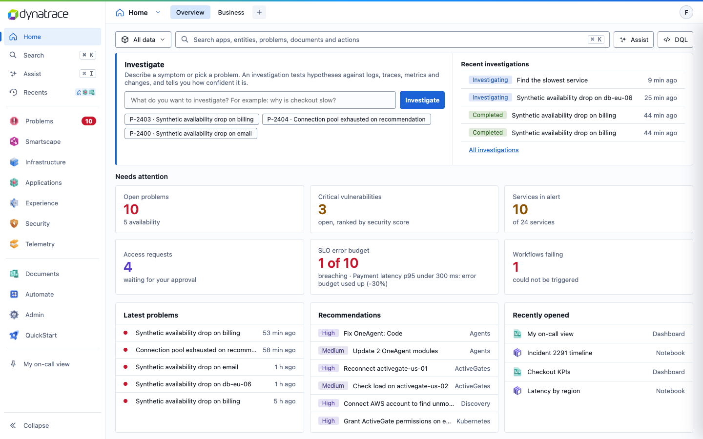

### 4.1 Left rail — Required

- **Order:** Home | Search, Assist, Recents | Problems, Smartscape, Infrastructure, Applications, Experience, Security, Telemetry | Documents, Automate, Admin, QuickStart | pinned items | Collapse.
- **Each app shows its icon and name.** The current app is highlighted with a left bar. Apps with something waiting show a count pip (Problems shows open problems).
- **Collapse** shrinks the rail to icons. The logo links to Home.
- Search and Assist show their keyboard shortcuts (⌘K, ⌘I).
- **Optional "Highlight menu groups"** (user menu): tints rail items by group (blue: Search, Assist, Recents, Documents, Automate, Admin; yellow: Infrastructure, Applications, Experience, Telemetry, QuickStart; purple: Home, Security, Smartscape). **Your call** whether to ship it. It was a review aid.

### 4.2 App header — Required

`[app icon + name ▾]  [tab] [tab] [tab] [+]  ...  [avatar]`

- **The app name is a link** to the app's start page (its first tab) and clears that tab's filters.
- **The chevron opens the app menu** ([screenshot](screenshots/23-app-menu.png)): Pin this view, Reset view, Copy link, What's new (the new tabs of this app with one line each), Documentation, Give feedback.
- **Tabs** carry badges (section 6.2). The **+** button opens "Add a document" (dashboard, notebook, launchpad).
- The **avatar** opens the user menu ([screenshot](screenshots/24-user-menu.png)): theme, highlight toggle, links, sign out.

### 4.3 Scope bar — Required

The bar under the header is the same on every view; controls only appear when they apply to the view (see "Scope" in `views.md`).

`[segment ▾] [ filter box ............ / ] [Filters] [Views ▾] [view-specific buttons] [Assist] [DQL] [timeframe ▾] [‹] [›] [⟳]`

- **Segment picker:** "All data" or a named segment (prod-eu, prod-us, staging…). It filters every view that holds segmentable data. The current segment is always visible as text.
- **Filter box:** free text plus `key:value` syntax (5.1.3). `/` focuses it from anywhere.
- **Filters:** shows or hides the facet panel.
- **Views:** saved filter sets per view; users can save their own.
- **Assist:** asks Assist about this view, with the view's context.
- **DQL:** a popover with the exact DQL for the current state, a DQL/dtctl switch and Copy ([screenshot](screenshots/25-dql-popover.png)).
- **Timeframe:** preset ranges, step back and forward (‹ ›), Now, Refresh. Only on time-based views.
- **Live** (Logs): streams new lines and hides the timeframe while on.

### 4.4 Global search (⌘K) — Required

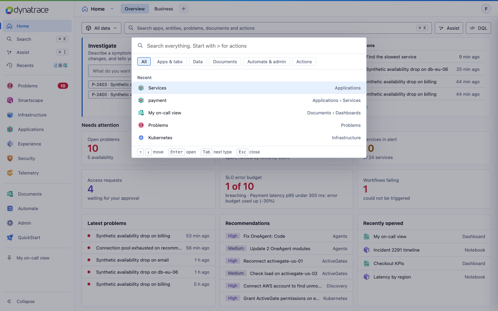

One palette for apps and tabs, data (entities, problems), documents and actions ("Create dashboard", "Start investigation"). Starting with `>` shows only actions. Chips filter by type. Recent items show when empty. **Datadog terms are understood:** "monitors" or "service map" find the Dynatrace equivalent.

### 4.5 Assist (⌘I) — Required (placement), Your call (content)

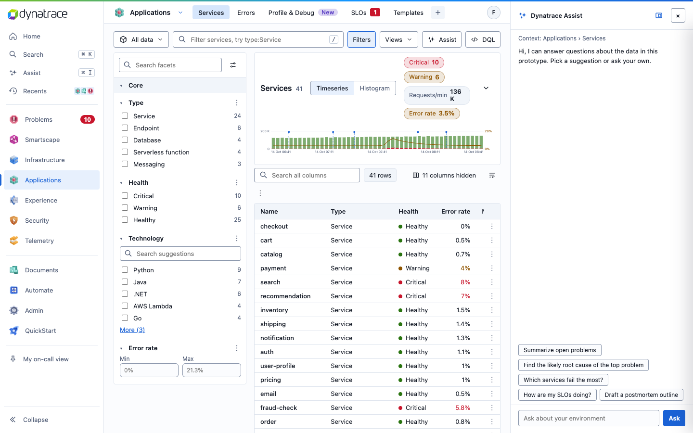

A panel on the right, docked (pushes the page) or floating (overlays). It always shows its context ("Context: Applications › Services") and offers suggestions for that context. "Explain"-style requests from any view (the Assist button, problem actions) open here with the view's data attached, so the answer is about what the user sees.

### 4.6 Recents — Recommended

A panel of recently visited views and items, grouped Today, Yesterday, Last 30 days, with search and pinning.

### 4.7 Themes — Required (light default), Your call (the set)

Light is the default. The prototype also has Dark, Midnight, Terminal, High contrast and Bluebox. There is **no "follow system" option** (removed on purpose). Build themes from tokens (7.1) so a new theme is only a token set.

---

## 5. Page patterns

### 5.1 Explorer (inventory view) — Required

The workhorse: 17 views use it (Hosts, Network, Clouds, Kubernetes, Cost, Services, Errors, Frontends, Synthetic, User analytics, Feature flags, Logs, Metrics, Traces, User sessions, Events, Vulnerabilities).

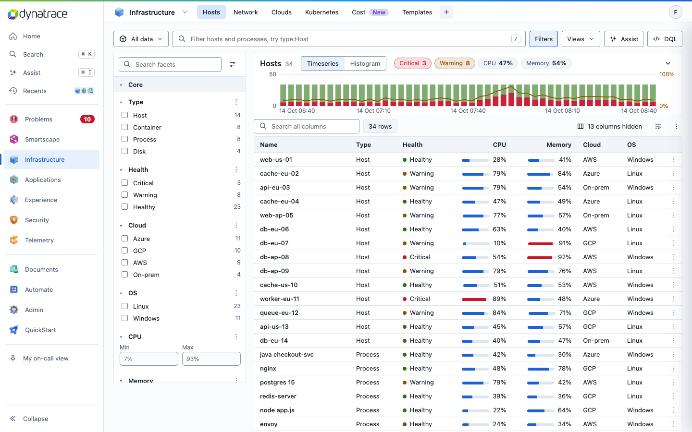

```
┌ scope bar ─────────────────────────────────────────────────────────────┐
├──────────────┬─────────────────────────────────────────────────────────┤
│ facet panel  │ overview panel: title + count · chart toggle · chips   │
│  search      │                 stacked bars + rate line               │
│  groups      ├─────────────────────────────────────────────────────────┤
│   facets     │ table toolbar: search all columns · rows · columns · ⋮ │
│              │ table (sortable, first column sticky, row menu ⋮)       │
└──────────────┴─────────────────────────────────────────────────────────┘
                                                details panel → (5.3)
```

#### 5.1.1 Overview panel — Required

- **Title and count:** the view name and the number of matching rows ("Hosts 34").
- **Stats chips** on the same row: 3–5 numbers that matter for this view (Critical 3, Warning 8, CPU 47%, Memory 54%). Chips that map to a facet value are **clickable filters**; click again to clear. Red, amber and purple chips carry meaning; others are neutral.
- **Chart:** **stacked bars over time** with the "bad" series (errors, unhealthy, failed) at the bottom in red and the rest stacked above it in green, plus an **amber line for the share of bad** on a second axis in percent. The legend shows on hover or focus. A **Histogram** toggle shows the distribution of one key field (duration, CPU, cost) with p50 and average markers.
- **Collapse** (chevron) hides the chart and keeps the chips.
- **Recommended:** keep the panel short (about 140 px). It was cut down twice because it pushed the table off screen.
- **Your call:** which numbers become chips, the chart library, and whether the rate line is always shown.

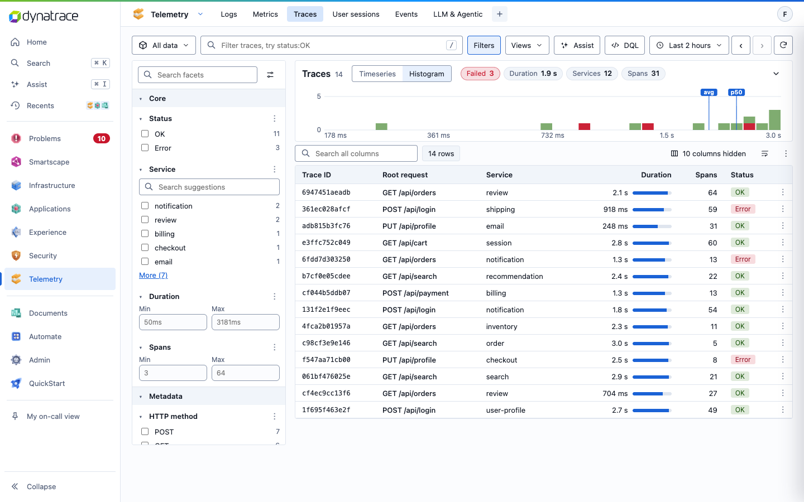

#### 5.1.2 Facet panel — Required

- **Search facets** at the top searches facet names and values.
- **Groups:** "Core" first, then "Metadata" (team, region, tags…). Groups collapse.
- **Value facets:** checkbox, value and count. The top 5 values show, then "More (N)". A per-facet search appears when a facet has many values.
- **Range facets:** min and max inputs (CPU, duration, cost).
- **Facet menu (⋮):** Clear selection, Hide facet. The settings icon shows hidden facets again.
- **Counts follow the other filters** (a facet's counts ignore its own selection).
- Selected values also show as removable chips under the scope bar, with "Clear all".

#### 5.1.3 Filter box with `key:value` search — Required

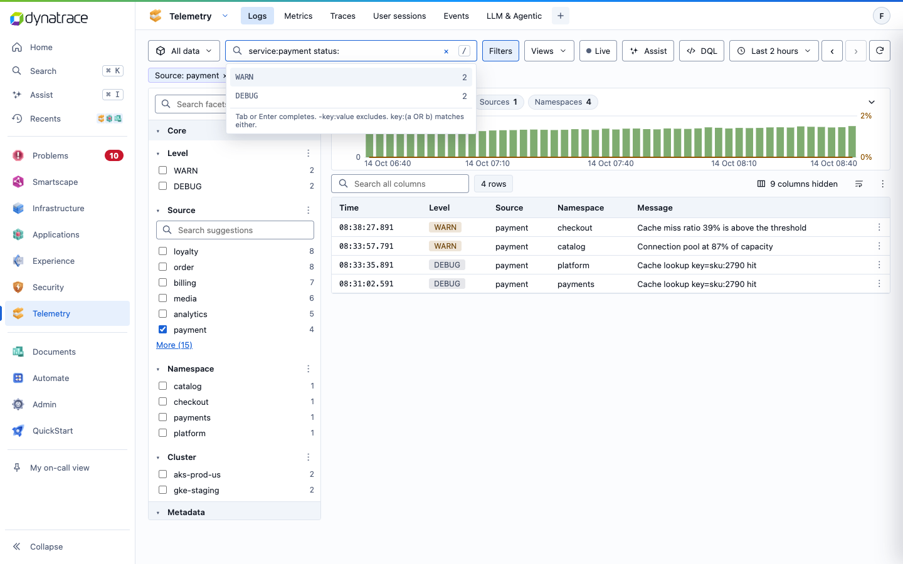

The filter box is the **single source of truth** for filtering. Facet clicks write into it, and typing into it updates facets.

| Syntax | Meaning |
|---|---|
| `checkout` | free text |
| `service:payment` | field equals value (facet values match case-insensitively) |
| `-ns:catalog` | exclude |
| `status:(error OR warn)` | any of |
| `cpu:>80`, `duration:<500`, `cost:100..500` | ranges on numeric fields |
| `host:web-*` | wildcard |
| `"two words"` | quoted value |

- **Keys** are the field label in snake case (`browser_or_os`), the field key, or a **Datadog alias** (`service`, `env`, `host`, `version`, `kube_namespace`…). Aliases are rewritten to the Dynatrace field.
- **Suggestions:** typing `key:` lists the top values with counts; numeric keys offer `>`, `<` and `a..b`. Tab or Enter completes.
- **The DQL popover translates the box live** into `filter` lines.
- **Recommended:** keep `s.q` (free text) and the structured filters in one state object, and clear both on "Reset filters". A bug class in the prototype came from clearing one but not the other.

#### 5.1.4 Table — Required

- **Toolbar:** "Search all columns" (searches hidden columns too, with a clear ×), row count, **column chooser** ("13 columns hidden" → checkbox list with search, Show all, Reset), wrap text, and a ⋮ menu (Export as CSV, Reset columns, Reset all filters).
- **Columns:** a small default set (5–8) and more in the chooser (see "Hidden columns" in `views.md`). The first column is sticky when scrolling sideways.
- **Sort** by clicking a header (keyboard reachable). **Row click** opens the details panel. **Row menu (⋮)** on the right edge: Open details, Copy name, then the related actions.
- **Cell types:** health dot + text, coloured tag, percentage with bar (red above 85%), duration (`1,240 ms`, `3.2 s`), relative time (`5 min ago`), monospace for IDs and versions, tag lists.
- **Paging:** 80 rows on desktop with "Show 80 more" (30 on phones). **Recommended:** virtualise instead if your result sizes are large; the backend decides how many rows exist.
- **Empty result:** "No hosts match. Reset filters" (with the button).

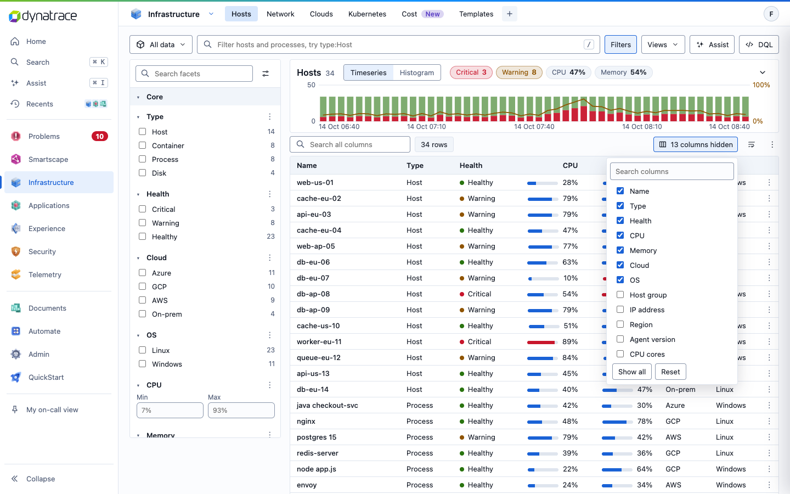

#### 5.1.5 Configuration — Recommended

Make the explorer data-driven so a new view is configuration, not code. A TypeScript shape that matches what the prototype needed:

```ts
type FieldKind = 'text' | 'number' | 'percent' | 'duration' | 'bytes' | 'currency'
               | 'relative-time' | 'health' | 'tag' | 'tags' | 'mono';

interface Column {
  key: string;            // field in the result record
  label: string;          // header, sentence case
  kind: FieldKind;
  numeric?: boolean;      // right-aligned, range-filterable
  hiddenByDefault?: boolean;
  tones?: Record<string, Tone>; // value → colour for tag cells
}

interface Facet { key: string; label: string; group?: 'Core' | 'Metadata' | string; range?: { unit?: string } }

interface StatChip {
  label: string;
  value: (rows: Row[], meta: ResultMeta) => string;
  tone?: Tone;                       // 'r' | 'a' | 'g' | 'p' | 'neutral'
  filter?: { key: string; value: string }; // makes the chip clickable
}

interface ExplorerChart {
  bucketValue: (row: Row) => number;  // weight per row (1, requests, cost…)
  badShare: (row: Row) => number;     // 0..1 share that is "bad"
  labels: { y: string; bad?: string; ok?: string };
  histogram?: { key: string; label: string; log?: boolean };
}

interface RelatedAction {
  label: string;                      // "Show logs", "Open in Smartscape"
  to: (row: Row) => RouteTarget;      // app, tab and filters to apply
}

interface ExplorerView {
  id: string; title: string; noun: string;     // noun: "hosts and processes"
  query: (s: ViewState) => DqlRequest;         // see 9.2
  rowQuery?: (row: Row) => DqlRequest;         // "Query this item" in the details panel
  columns: Column[]; facets: Facet[]; stats: StatChip[];
  chart?: ExplorerChart; related: RelatedAction[];
  scope: { segment: boolean; timeframe: boolean; live?: boolean };
  modes?: { label: string; view: Partial<ExplorerView> }[]; // e.g. Vulnerabilities: Prioritization, Findings
}
```

**Your call:** whether the chart series come from the row query or a separate `makeTimeseries` query. The prototype derives them from rows only because it has no backend; a real chart should query time buckets (see 9.3).

### 5.2 Simple list — Required

Problems, Recommendations, SLOs, Templates, User audits, the Documents tabs, Workflows, Executions, Guardians and the Admin tabs use a lighter version: facet panel, table, details panel, no overview chart. Some add **scope chips** above the table (Documents: All, Mine, Shared with me, Ready-made, Favorites, Trash). A **board** layout (List / Board by status) also exists, on the Feature flags explorer.

- **Recommended:** convert these to the explorer once it exists. The review found the two generations side by side confusing (Open decision 14.3).

### 5.3 Details panel — Required

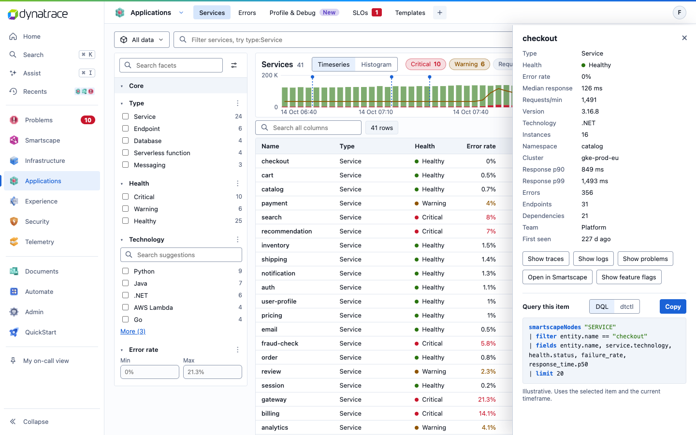

A panel slides in from the right on row click. Same structure everywhere:

1. **Title** (the item's name) and close ×.
2. **Key-value list** of every column, including hidden ones.
3. **Related actions** as buttons (Show traces, Show logs, Show problems, Open in Smartscape…). They open the target view already filtered to this item.
4. **"Query this item"**: the DQL for this one item, a DQL/dtctl switch and Copy. Some types also offer **"Manage as code"** (dtctl, API, Terraform, Monaco) for SLOs, workflows and templates.

Rules: Esc closes it. **Focus returns to the row that opened it** (a fixed accessibility bug). On phones it is full screen.

### 5.4 Problems and investigations — Required

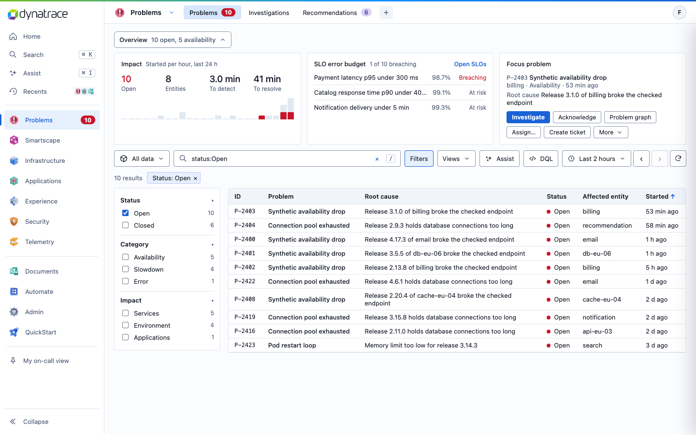

- **Overview** (collapsible): Impact (open count, entities, time to detect and resolve, problems started per hour), SLO error budget (worst three, with a link), **Focus problem** (the oldest open problem) with Investigate, Acknowledge, Problem graph, Assign…, Create ticket and a More menu.
- **Table:** ID, problem, **root cause**, status, affected entity, started. The root cause leads; category and impact moved to filters and the details panel.
- **Problem details** start with the root cause, then evidence and actions ([screenshot](screenshots/03-problem-details.png)).
- **Investigations** ([screenshot](screenshots/04-investigation.png)): a phase stepper (Situational overview → Hypothesis formation → Investigation → Mitigation → Final report), a summary row (system status, root cause, blast radius, customer impact, primary signal), then collapsible sections: Executive summary, Recommended actions, Impact & blast radius, Context & signals, Root cause & hypotheses, Evidence trail (each item tagged Supports, Refutes or Neutral), Finding & trigger.
- **Your call:** the AI content and how investigation progress streams in.

### 5.5 Smartscape — Required (behaviour), Your call (rendering)

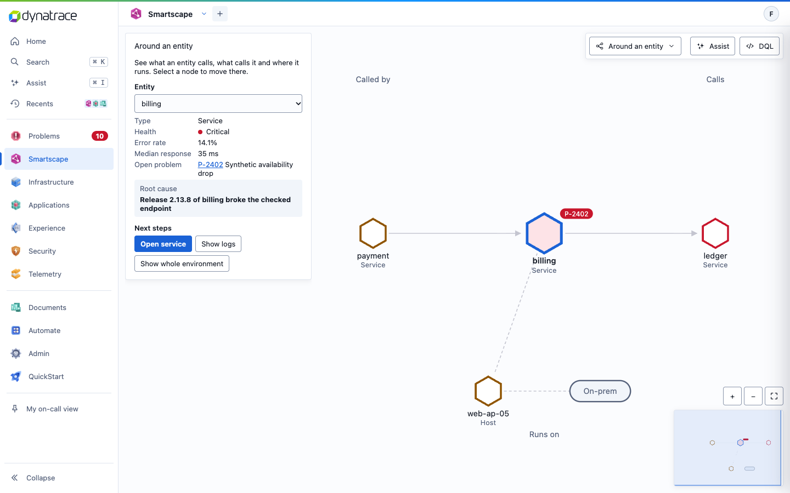

- **One page with a view picker**, no tabs: Around an entity (default), Problem graph, Smartscape on Grail, Infrastructure overview, Service dependency graph, Kubernetes, AWS, Azure, AI Observability, Security problem, Network devices.
- **Around an entity:** the selected entity in the middle, "Called by" on the left, "Calls" on the right, "Runs on" below. Selecting a node moves there. The side panel shows health, the open problem, the root cause and next steps.
- **Large graphs** ([Grail view, about 15,000 nodes](screenshots/12-smartscape-grail.png)) group by environment (AWS, Azure, on-premises zones), use a force, vertical or horizontal layout, and offer find, type filters, "Affected by problem" and "Hide unconnected nodes". Clicking a node highlights it and its neighbours.
- **Shared controls:** zoom +/−, fit, mouse-wheel zoom, drag to pan, a mini map. One overlay panel on the left that collapses as a whole.
- **Problem graph** ([screenshot](screenshots/13-problem-graph.png)): columns Root cause → Directly affected → Impacted frontends → Users, with a spread selector (1–3 hops).
- **Required for performance:** render large graphs on canvas or WebGL, not one DOM/SVG element per node (11.2).

### 5.6 Custom pages — Recommended (layout), Your call (details)

| Page | What matters | Screenshot |
|---|---|---|
| **Profile & Debug** | Show / by / for controls, a flame graph with drill-in and breadcrumbs, a timeline, a service facet, a breakdown panel; also Timeseries, Table and Profile list views. | [14](screenshots/14-profile-debug.png) |
| **Heatmaps** | Click map and scroll map over a page screenshot; device switch; top elements list (hover highlights the element); rage, dead and error clicks as filter chips; a draggable scroll-depth line. | [15](screenshots/15-heatmaps.png) |
| **User analytics** | Explorer with three modes: Users, Pages (Core Web Vitals), Journeys (conversion, drop-off). | [16](screenshots/16-user-analytics.png) |
| **SIEM** | MITRE ATT&CK matrix with coverage per tactic; a technique panel lists active and available detection rules with toggles. | [17](screenshots/17-siem.png) |
| **Feature flags** | List or board by status; a detail page per flag with environments, rollout and evaluations. | [18](screenshots/18-feature-flags-board.png) |
| **Cost** | Explorer of cloud and on-premises spend per entity, idle share, rightsizing, potential savings. | [26](screenshots/26-cost.png) |
| **Home** | Investigate box (free text or pick a problem), recent investigations, "Needs attention" tiles, latest problems, recommendations, recently opened. | [01](screenshots/01-home.png) |
| **QuickStart** | "Coming from Datadog?" glossary (29 terms → Dynatrace place), add data, an environment overview, charts, findings. | [20](screenshots/20-quickstart.png) |

### 5.7 Datadog comfort — Recommended

For teams switching from Datadog: the `key:value` syntax with Datadog aliases (5.1.3), service versions and deploy markers on the Services chart, the QuickStart glossary, Datadog terms in search, and a "Compared with Datadog" write-up in the user menu (shareable link). The glossary is an experiment; keep it easy to remove.

---

## 6. Components and states

### 6.1 Buttons and links — Required

- One **primary** button per area at most ("Investigate", "Create workflow"). Others are secondary (outlined) or ghost.
- Icon-only buttons need an accessible name and a tooltip.
- Destructive actions ask for confirmation in place ("Remove 'X'? The dashboard is deleted and its tab closes.").

### 6.2 Badges and chips — Required

| Use | Look | Examples |
|---|---|---|
| Something is broken, counts | **red** count | Problems (round), Synthetic failing, SLOs breaching, Vulnerabilities critical (square for Security and SLOs) |
| New or "for you" | **purple** | "New" label on new tabs (Cost, Profile & Debug, Heatmaps, SIEM); Recommendations count; Access requests count |
| Status in a table | tinted tag | Healthy green, Warning amber, Critical red, Investigating blue |
| Filter chip | outlined pill with × | "Status: Open ×" |
| Stats chip | pill with label and value | "Critical 3" (red), "CPU 47%" (neutral) |

**Required:** never use yellow or amber for "new" or neutral counts. Amber means a warning.

### 6.3 Menus and popovers — Required

Open on click, close on outside click, Esc and **route change** (a prototype bug left a row menu open on the next page). Keyboard: arrow keys move, Enter selects. Menus near the screen edge flip to stay visible.

### 6.4 Expand and collapse — Open decision

The prototype has four styles, which is the main inconsistency left. See 14.1 before building any collapsible section.

### 6.5 Loading, empty, error and permission states — Required (new; the prototype has mock data and none of these)

| State | Rule |
|---|---|
| **Loading** | Skeletons in place of the table rows and chart. Keep the scope bar and facets interactive. Never blank the page. |
| **Slow query** | After about 2 s, show progress text ("Scanning 3.2 TB…" if your backend reports it) and a Cancel. |
| **Partial or truncated** | When the result was cut (row limit, sampling, `truncated` from dtctl), say so above the table, with a way to narrow the query. |
| **Empty** | Say why and offer the next step: "No hosts match. Reset filters" or, for new environments, "Connect an AWS account to see cloud resources here." |
| **Error** | Inline in the area that failed, with the reason in plain words, Retry, and "Copy DQL" so the user can debug. The rest of the page keeps working. |
| **No permission** | Show the action disabled with the reason on hover ("You can view workflows but not change them"). Don't hide it, so people know it exists. Map this to the dtctl safety level or token scopes your backend reports. |
| **Stale** | If data is cached, show "Updated 2 min ago" next to Refresh. |

### 6.6 Toasts — Recommended

Short confirmation after an action ("Link copied", "Pinned 'Kubernetes'"), bottom of the screen, about 2 s, announced to screen readers. Not for errors that need action.

---

## 7. Visual design

### 7.1 Tokens — Recommended (values), Required (use tokens, not literals)

Light theme values from the prototype. Every colour in components refers to a token.

| Token | Light | Dark | Use |
|---|---|---|---|
| `--bg` | `#fbfcfe` | `#0d1117` | page background |
| `--panel` | `#ffffff` | `#161b22` | cards, panels |
| `--panel2` | `#f1f5fa` | `#1c2330` | table headers, subtle fills |
| `--line` / `--line2` | `#dfe5ee` / `#c5cfdd` | `#2d333b` / `#444c56` | borders |
| `--text` | `#141a26` | `#e6edf3` | body text |
| `--muted` | `#55617a` | `#8b97a8` | secondary text (meets 4.5:1 on panels) |
| `--accent` | `#1a62d6` | `#58a6ff` | links, primary, selection, focus |
| `--g` | `#2a7410` | `#3fb950` | healthy, success |
| `--a` | `#8f5400` | `#d29922` | warning only |
| `--r` | `#c8162c` | `#f85149` | critical, errors, problem counts |
| `--p` | `#5b3fc4` | `#a78bfa` | new, recommendations, access requests |
| `--rad` | `4px` | | corner radius |

Tag text is mixed 74% tone and 26% text colour on a 15% tone background, which keeps every status tag at or above 4.5:1. Chart colours: bad series `--r`, ok series `--g` at 60%, rate line `--a`.

### 7.2 Type and density — Recommended

- System UI font, 13 px base, **12 px minimum** for any text (axis labels included).
- Monospace (`ui-monospace`) for IDs, versions, DQL and code.
- Dense but not cramped: table rows of about 30 px on desktop, an 8–16 px spacing scale.

### 7.3 Icons — Recommended

Product app icons for apps (the PNG/SVG set in `dynatrace-explore-apps-screenshots/dynatrace-app-icons/`), line icons (1.7 px stroke) for actions. Icons never carry meaning alone.

### 7.4 Charts — Required (rules), Your call (library)

- Stacked bars for counts over time, the "bad" part at the bottom in red.
- A line on its own axis (percent) for a rate; never two unrelated units on one axis without labelling both.
- Legend on hover or focus is accepted for small charts; give every chart an accessible summary (8).
- Deploy markers: a dashed vertical line with the version label.
- Axis labels: fewer on narrow widths (the prototype shows 3 instead of 5 below 520 px).

---

## 8. Accessibility

*Required.*

Target WCAG 2.2 AA. What the prototype already does, and what's still open:

| Done in the prototype | Still open |
|---|---|
| Visible 2 px focus ring | Text alternative for charts (summary or data table) |
| Every button and field has an accessible name | Keyboard access to Smartscape nodes (list view or focusable nodes) |
| Esc closes panels and menus; focus returns to the opener | Tab strip semantics (links with `aria-current` or real tabs with panels; currently `role="tab"` without panels) |
| Skip link and a page heading per view | A few low-contrast leftovers (SIEM labels) |
| 4.5:1 text contrast for tags, purple, green and amber | Hover-only legends and tooltips on touch |
| 12 px minimum text; 44 px tap targets on phones | |
| Sortable headers and rows are keyboard reachable | |

---

## 9. Data, state and dtctl

### 9.1 Where dtctl sits — Required

The browser never runs dtctl and **never holds a Dynatrace token**. Your backend runs dtctl (the CLI, its Go engine `pkg/engine`, or `dtctl serve http`) and exposes an API to the UI. Auth (OAuth login, contexts, environments) happens in the backend; the UI only knows the user's session with your backend.

```
React UI ──(your session/cookie)──▶ your backend ──▶ dtctl (query, get, describe, apply…) ──▶ Dynatrace
```

Facts about dtctl that shape the UI (from its public docs; check against the version you run):

- **Queries:** `dtctl query "<DQL>"` returns `records` (and `types` with `--include-types`). `--typed` returns numbers as numbers instead of strings. Results can be truncated or paged (`has_more` in agent mode).
- **Resources:** kubectl-style verbs on workflows, dashboards, notebooks, SLOs, settings, segments, documents and more: `get`, `describe`, `create`, `edit`, `apply`, `delete`, `execute`.
- **Safety levels:** `readonly`, `readwrite-mine`, `readwrite-all`. Surface them as disabled actions with a reason (6.5).
- **Server mode is buffered:** `dtctl serve http` refuses `--live`, `--watch` and `--follow`. **Live logs need your own streaming or polling** (9.4).

### 9.2 What the UI asks of the backend — Recommended interface

You already built these calls. Map them onto a small, typed client so components don't care about transport:

```ts
interface DqlRequest {
  dql: string;                       // the view's query, already including filters
  timeframe?: { from: string; to?: string };  // e.g. "now()-2h"
  segment?: string;                  // "all" or a segment id
  limit?: number;
  typed?: boolean;                   // numbers as numbers
}

interface DqlResult<Row = Record<string, unknown>> {
  records: Row[];
  types?: Record<string, string>;    // field → type, from --include-types
  meta: {
    truncated?: boolean;
    hasMore?: boolean;
    durationMs?: number;
    scannedBytes?: number;           // if your backend reports it
  };
}

interface DtClient {
  query<Row>(req: DqlRequest, signal?: AbortSignal): Promise<DqlResult<Row>>;
  get(resource: string, opts?: { filter?: string }): Promise<unknown[]>;       // dtctl get
  describe(resource: string, id: string): Promise<unknown>;                    // dtctl describe
  apply(resource: string, body: string): Promise<{ id: string }>;              // dtctl apply
  execute(resource: string, id: string, input?: unknown): Promise<unknown>;    // e.g. run a workflow
  me(): Promise<{ name: string; environment: string; safetyLevel: string }>;
}
```

A view hook then stays small:

```ts
function useView(view: ExplorerView, state: ViewState) {
  const req = useMemo(() => view.query(state), [view, state]);
  return useQuery({                     // TanStack Query or your own
    queryKey: ['dql', req],
    queryFn: ({ signal }) => client.query(req, signal),
    staleTime: 30_000,
    placeholderData: keepPreviousData,  // keep the old table while refetching
  });
}
```

**Your call:** caching, batching (facet counts and chart buckets can be one round trip or several), and whether facet counts come from the same query.

### 9.3 Queries per view — Recommended

- `views.md` has the prototype's DQL for every view. It is illustrative: field names and filters are plausible, not verified against your data model. **Your tuned queries replace them.**
- **Each view needs up to four queries:** rows (table), time buckets (chart), facet counts and stats chips. Decide per view whether they share one query.
- **The DQL shown in the UI must be the DQL that ran** (or equivalent), including the filters from the filter box. That's the promise in principle 5.
- **Copy as dtctl** in the prototype builds `dtctl query '<DQL>' -o table [--segment <id>]`. Since your backend uses dtctl, generate this string from the same request object. The `--segment` flag is the prototype's guess; use whatever your dtctl version actually supports.

### 9.4 Global state — Required

| State | Scope | Persist |
|---|---|---|
| Timeframe and segment | global, shared by all views | URL + session |
| Filters, sort, columns, chart mode | per view | URL (recommended) + local |
| Saved views | per view, per user | backend |
| Theme, rail collapsed, menu highlight | per user | local storage is fine |
| Pinned items, recents | per user | backend recommended (prototype: memory only) |
| User documents (+ tabs) | per user | backend (prototype: local storage) |
| Live mode | per view | none |

- **Live mode (Logs):** poll every 1–5 s or stream from your backend. Pause while the user hovers the table or has the details panel open (the prototype does this, and it avoids rows jumping under the cursor).
- **Mock-data trap:** the prototype's numbers are generated. Don't port any mock values, generators or distributions.

---

## 10. Phone layout

*Required (scope), Recommended (details).*

Phones get a **read-only subset** for on-call use, not the full product.

| Phone problems | Phone menu | Services as cards | Details full screen |
|---|---|---|---|
| 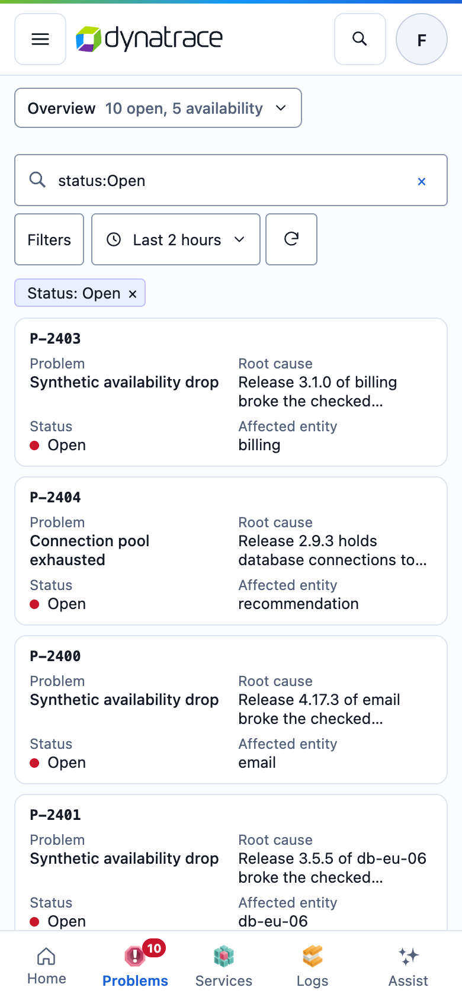 | 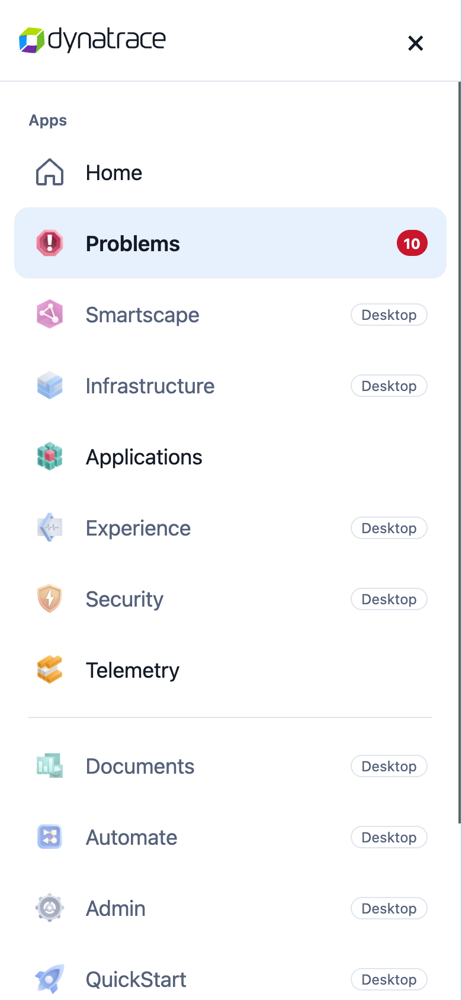 | 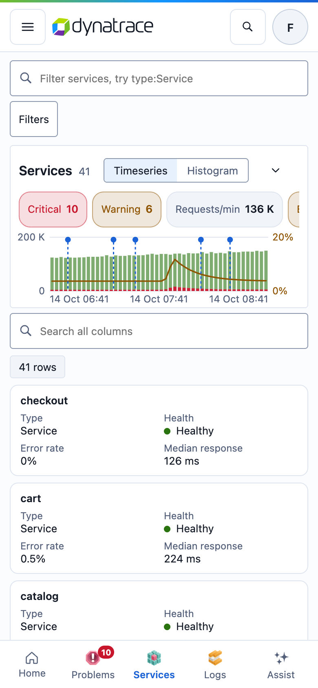 | 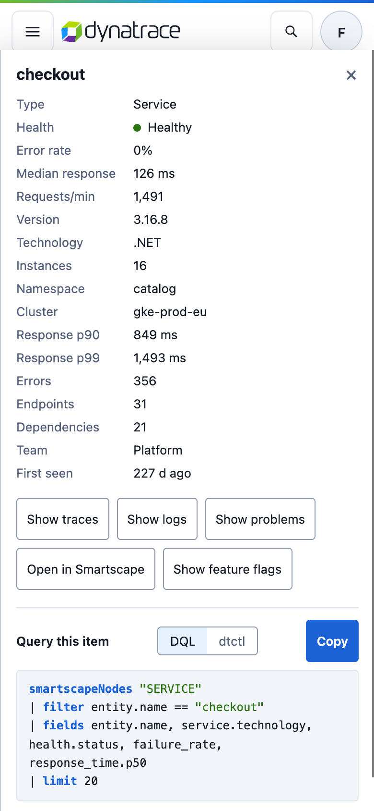 |

- **Below 700 px:** Home, Problems, Investigations, Services, Logs and Assist. Every other view shows "Best on a larger screen" with links to the supported ones ([screenshot](screenshots/34-phone-unsupported.png)).
- **Header:** burger menu, logo, search, avatar. The **burger menu** is full width with 60 px rows and lists every app; apps not available on phones are dimmed with a "Desktop" label.
- **Bottom bar:** Home, Problems (with count), Services, Logs, Assist.
- **Tables become cards** (first column as the card title, the next 4–5 fields as label/value pairs). Filters open as a bottom sheet with Done. Details and Assist are full screen.
- **Tap targets 44 px**, inputs 16 px (prevents iOS zoom), no sideways page scroll.
- Only tested in emulation. **Test on real iOS Safari and Android Chrome.**

---

## 11. Performance

*Recommended.*

Budgets the prototype met with mock data; your real data will be harder.

### 11.1 General

- Interaction to visual feedback under 100 ms; keep previous results visible while refetching.
- Cancel in-flight queries when filters change (`AbortSignal`).
- Debounce the filter box (about 150 ms) before querying; update the chips immediately.
- Virtualise tables above a few hundred rows.

### 11.2 Smartscape and large graphs

- **Canvas (or WebGL), not SVG/DOM per node.** The prototype measured: SVG with 1,000 nodes (4,200 elements) ran at about 9 fps when panning; canvas with one path per colour runs at 60 fps up to about 70,000 nodes.
- Batch viewport updates to one per animation frame; keep line widths constant when zooming.
- Hit-testing via a spatial grid, not per-node DOM listeners.
- **Don't** attach non-passive `wheel` listeners to `document`; bind zoom to the graph element only. A page-wide wheel listener made every page scroll worse.

### 11.3 Phone scrolling

Passive scroll listeners only, fewer rows per page (30), no `content-visibility` tricks (they moved layout into the scroll and made it worse).

---

## 12. Build order

*Recommended.*

1. **Foundations:** tokens and themes, typography, buttons, tags, chips, menus, focus handling, toasts.
2. **Shell:** rail, header with app menu and tabs, routing with URL state, scope bar (segment, filter box, timeframe, DQL popover).
3. **Data client and view state** (9.2, 9.4), with loading, empty, error and permission states (6.5).
4. **Explorer** (5.1) and **details panel** (5.3), first on Hosts and Services, then the other 15 explorer views as configuration.
5. **Problems and investigations** (5.4).
6. **Global search, Assist panel, recents.**
7. **Smartscape** (5.5).
8. **Simple lists** (5.2), ideally converted to the explorer.
9. **Custom pages** (5.6).
10. **Phone layout** (10).
11. **Datadog comfort** (5.7).

---

## 13. Lessons from the prototype

Things that went wrong once and shouldn't happen again:

- **Menus and panels survived route changes** (a row menu stayed open on the next page). Close all transient UI on navigation.
- **Filters were not in the URL**, so "Copy link" couldn't share a filtered view.
- **Two table generations** confused reviewers (5.2).
- **Status colours drifted** (yellow for "new", amber for counts). Fixed by the purple rule (6.2).
- **Expanders disagree on arrow direction** (14.1).
- **The overview header was too tall** and was condensed twice (5.1.1).
- **Charts were confusing** until they became stacked bars with a rate line and chips instead of thin lines and coloured underlines (5.1.1).
- **Clearing filters must clear all filter state**, free text and structured (5.1.3).
- **Performance traps:** SVG per node, a document-wide wheel listener, `content-visibility` on scroll lists (11).
- **Two people (or agents) editing in one working folder** swept each other's changes into commits. Use one git worktree per person or agent.

---

## 14. Open decisions

| # | Decision | Options | Recommendation |
|---|---|---|---|
| 14.1 | **Expand/collapse pattern** | pill with a right chevron (˅ closed, ˄ open: Problems overview, QuickStart glossary); left caret (▸ closed, ▾ open: investigation sections, facet groups); right ▾ (old facets); none (Profile & Debug Insights) | ▸ closed / ▾ open, on the left, everywhere |
| 14.2 | Name of the alerting tab in Problems | "Alert rules" or "Alerting" | not decided |
| 14.3 | Convert simple lists to the explorer | Investigations, SLOs, Workflows, Dashboards, Coverage | convert |
| 14.4 | Menu group highlight | ship or drop | review aid; drop unless users ask |
| 14.5 | Live data transport | polling or streaming from your backend | your call (dtctl server mode can't stream) |
| 14.6 | Where saved views, pins, recents and user documents live | backend or local | backend |

---

## 15. Appendix: working with Claude Code

### 15.1 A `CLAUDE.md` block for your repo

```md
## UI rules (from docs/ui-spec)
- Read docs/ui-spec/README.md before adding or changing a view. views.md lists every view.
- New list views are explorer configurations (ExplorerView), not new page components.
- Colours come from tokens only. Red = broken, purple = new/for you, amber = warning only.
- Wording: sentence case; "Open" navigates, "Show" filters a list, "Create" makes something.
- Every view shows the DQL it ran (DQL popover and "Query this item"). Keep them in sync with the real query.
- Every transient menu or panel closes on route change and on Esc; focus returns to the opener.
- The browser never sees a Dynatrace token. All Dynatrace access goes through the backend client (dtctl underneath).
- Each agent or person works in its own git worktree; changes go through a PR.
```

### 15.2 Prompt templates

- **New explorer view:** "Add the Kubernetes explorer view as an `ExplorerView` configuration. Use docs/ui-spec/views.md § Infrastructure / Kubernetes for columns, facets, stats and related actions, and the backend query `<name>` for data. Match screenshot 05 for layout. Include loading, empty and error states."
- **Pattern component:** "Build the details panel per docs/ui-spec/README.md § 5.3, including focus return, Esc, related actions and the 'Query this item' block with a DQL/dtctl switch. Write tests for focus return."
- **Review:** "Check this branch against docs/ui-spec/README.md §§ 6–8 (states, visual rules, accessibility) and list deviations."

### 15.3 Using the prototype as a reference

The prototype is one file (`site/new/index.html`, about 750 KB). Useful entry points when you want to see how something behaves: `APPS` (all apps and tabs), `EXPLORER` (explorer configurations), `renderTable`/`exPanel`/`exFacets`/`exGrid` (explorer), `openDrawer`/`dqlRow` (details panel), `kvParse`/`kvSuggest` (key:value search), `dqlFor` and the `DQL` map (queries), `renderSmartscape`/`ssPaint` (graph), `renderRail`/`renderHead` (shell), `MOB_OK`/`renderMmenu` (phone). Don't port its code: it's optimised for being a single static file with mock data.

Serve it locally:

```bash
cd site && python3 -m http.server 8000   # then open http://localhost:8000/new/
```
